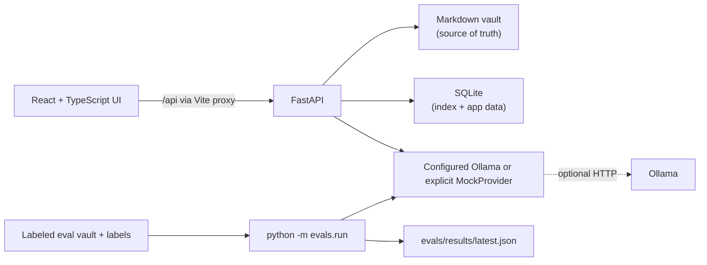

<p align="center">
  
</p>

# CurZ

Your notes become a brain you can see, question, and trust.

> Renamed from Threadwise; existing vaults and saved settings are preserved.

CurZ is a local-first, Obsidian-compatible workspace. Markdown files in
your vault are the source of truth; SQLite provides the searchable index and
stores derived app data.

## What is built

- Markdown vault open/create, indexing, full-text search, tags, wikilinks,
  backlinks, revisions, archive/restore, and permanent delete.
- Notes editor with autosave, retryable save errors, recovery draft, and
  wikilink completion.
- Home quick capture, recent notes, inbox items, keyboard command palette,
  and navigation/theme controls.
- Brain graph with explicit links, BM25/TF-IDF similarity, accepted typed
  relationships, Louvain clusters, saved layout, replay, and an accessible
  table view.
- Evidence extraction with source-quote verification and stale-evidence
  handling; AI suggestions remain pending until a person reviews them.
- Grounded Ask with scoped retrieval and verified citations; Evolution,
  Bridges, Gaps, and deterministic Revisit suggestions.
- Optional Ollama integration, clearly labeled deterministic Demo Mode,
  sample vault, and measured Trust Report.

AI is optional. Notes, search, explicit links, and the graph work without an
AI provider. Demo Mode is mock output, not model intelligence.

## Screenshots to capture

These are capture placeholders; no screenshots are included yet. Upload
`frontend/public/brand/og-image.png` in the GitHub repository settings as the
social preview image.

- Home with quick capture and “Why now?”
- Notes editor with wikilink completion and the Links Lens
- Brain graph with explicit, semantic, and accepted reasoned layers
- Brain Replay controls and date label
- Review relation card and side-by-side tension card
- Ask answer with verified citation open in the note
- Evolution timeline with verified claims
- Trust Report showing the actual provider, run date, and measured metrics

## Requirements

- Windows 10/11 and PowerShell
- Node.js 22 LTS (npm 10 or newer)
- Python 3.12 or 3.13 available as `python`
- Git

Before setup, check that `python --version` reports Python 3.12 or 3.13.
`npm run setup` creates the virtual environment using the `python` found on
`PATH`.

## Run on Windows PowerShell

Clone the repository (enter its real URL when prompted), then install the
frontend and backend dependencies:

```powershell
$RepositoryUrl = Read-Host "Paste the CurZ repository URL"
git clone $RepositoryUrl curz
Set-Location .\curz
node --version
npm --version
python --version
git --version
npm run setup
```

Start the backend and frontend together:

```powershell
npm run dev
```

Open the frontend URL printed by the launcher. It normally uses
`http://localhost:5173` and the backend normally uses `http://127.0.0.1:8000`.
If either port is occupied, the launcher selects available ports and pairs the
frontend proxy with its backend. The page shows **Backend: connected** when
`GET /api/health` succeeds. Press `Ctrl+C` in the terminal to stop both
servers.

On first use, open an existing vault folder or create one with its full path.
Notes are stored as `.md` files inside that folder. Quick captures are separate
files under `Inbox/` with UTC timestamp names.

## Optional local AI with Ollama

1. Install Ollama for Windows from [ollama.com/download/windows](https://ollama.com/download/windows), then start the Ollama app.
2. In a new PowerShell window, pull a chat model and (optionally) an embedding
   model:

   ```powershell
   ollama pull qwen3:8b
   ollama pull nomic-embed-text
   ollama list
   ```

3. In CurZ, open **Settings**, enter the model names exactly as shown by
   `ollama list`, keep the URL at `http://127.0.0.1:11434`, save, and choose
   **Test connection**. Embeddings are optional; Ask and search retain BM25
   retrieval without them. Model memory requirements depend on the machine.

Alternatively, enable **Demo Mode (MockProvider)** in Settings. It produces
deterministic responses that the UI and API label as mock. Turn Demo Mode off
to test Ollama. The backend defaults are safe and do not require a `.env` file;
`backend\.env.example` documents the supported environment variables.

## Architecture



The root `npm run dev` launcher starts both local servers. SQLite is used for
the index, search, graph state, settings, revisions, and AI-derived data; it
does not replace the Markdown vault.

## How the Proof Engine works

Claim extraction sends one selected note to the configured provider. The
backend normalizes the source and proposed quote for whitespace, Markdown
markers, case, and common quote/dash differences, then checks that the quote
matches. A verified quote is stored with offsets into the original note;
unmatched quotes are discarded and counted. On note edits, stored evidence is
checked again and missing evidence becomes **Stale**, not silently deleted.
Only verified quotes are shown as proof. AI-derived claims and evidence are
stored in SQLite, not written into Markdown files.

## Tests and evaluations

Run the frontend unit tests and backend test suite:

```powershell
npm test
```

Run individual checks:

```powershell
npm run typecheck
npm run lint
npm run build
```

The Playwright journeys cover creating/reloading a note, searching/opening a
note, and loading the sample vault/Brain. Install Chromium once, then run them:

```powershell
Push-Location .\frontend
npx playwright install chromium
Pop-Location
npm run e2e
```

Run the labeled evaluation with MockProvider:

```powershell
$env:CURZ_EVAL_PROVIDER = "mock"
npm run eval
Remove-Item Env:CURZ_EVAL_PROVIDER
```

The same evaluation can use configured Ollama by setting
`$env:CURZ_EVAL_PROVIDER = "ollama"` instead. It uses only the labeled
fixture in `evals\vault`, never the user's selected vault, and writes the
provider, model, date, and measured results to `evals\results\latest.json`.
Trust Report metrics include raw quote fabrication before verification,
post-verification citation validity, labeled relationship precision/recall,
Ask retrieval hit@k, and honesty on unanswerable questions. Empty denominators
are reported as **Not measured**; MockProvider results are explicitly marked
and are not real-model quality measurements.

## Privacy

The app runs locally by default. It does not automatically send notes to an AI
provider: an AI request sends only the material needed for the action, such as
the selected note for claim extraction, shortlisted note pairs for relationship
suggestions, or retrieved chunks for Ask. Ask does not send the whole vault and
includes at most the last four question/answer turns as conversation context.
The app does not log full notes or prompts and has no telemetry feature.

Ollama defaults to the local address above. If you configure a different
provider URL or host, the submitted task material is sent to that destination.
Review the configured provider before using AI with sensitive notes.

## Backup and restore

Back up the entire vault folder to preserve your Markdown notes. To restore,
open that folder in CurZ and rescan it; the note index and full-text
search can be rebuilt from the files. SQLite also stores revisions, settings,
verified evidence, relationship/review state, and other derived data that a
rescan cannot recreate. To preserve that state too, close CurZ and back
up `backend\curz.db` alongside the vault. If the vault was moved, open
its new folder path after restoring.

## Obsidian compatibility

Notes are ordinary UTF-8 Markdown files and use YAML frontmatter, `[[wikilinks]]`,
and `[[wikilinks|aliases]]`. Obsidian can open the same vault. CurZ's
search index, AI evidence, review decisions, and graph layout are app data in
SQLite, not Obsidian metadata. Plugin behavior and every Obsidian-specific
extension are not guaranteed.

## Troubleshooting

- **Port in use:** `npm run dev` normally chooses another available port and
  prints the correct frontend URL. Use that URL rather than assuming 5173.
- **PowerShell blocks `npm.ps1`:** run the same npm commands with `npm.cmd`,
  for example `npm.cmd run setup` and `npm.cmd run dev`. This avoids changing
  the machine-wide execution policy.
- **Ollama unreachable:** start the Ollama app, check `ollama list`, and confirm
  Settings uses `http://127.0.0.1:11434`. Notes, search, links, and graph work
  without Ollama.
- **Model not found:** run `ollama pull <model-name>` using the exact model
  name configured in Settings, then choose **Test connection** again.
- **FTS5 unavailable:** check whether the Python SQLite build includes FTS5:

  ```powershell
  backend\.venv\Scripts\python.exe -c "import sqlite3; c=sqlite3.connect(':memory:'); c.execute('create virtual table f using fts5(x)'); print('FTS5 available')"
  ```

  If that raises an SQLite error, install a supported Python 3.12/3.13 build
  with FTS5 enabled, ensure it is the `python` on `PATH`, then rerun
  `npm run setup`.

## Known limitations

- CurZ is a local single-user app; it does not provide hosted sync or
  multi-user collaboration.
- AI output depends on the configured model. MockProvider is for tests and
  demonstrations only and must not be interpreted as model evidence.
- The database contains app state that cannot be reconstructed from Markdown
  alone; keep a database backup if that state matters.
- Large graphs can take time to lay out and render, depending on the machine's
  WebGL support.

## Roadmap

### Shipped

Local Markdown vault, note editing and recovery, full-text search, links and
backlinks, Brain graph and replay, verified evidence, human-reviewed
relationships and tensions, grounded Ask, Evolution, Bridges and Gaps,
Revisit, sample vault, and measured Trust Report.

### Next

Broaden automated browser coverage in CI, continue large-graph performance
work, and improve the backup/restore experience.

### Ideas

Explore optional multi-device workflows, collaboration, or packaged desktop
distribution. These are ideas only, not current features or commitments.
